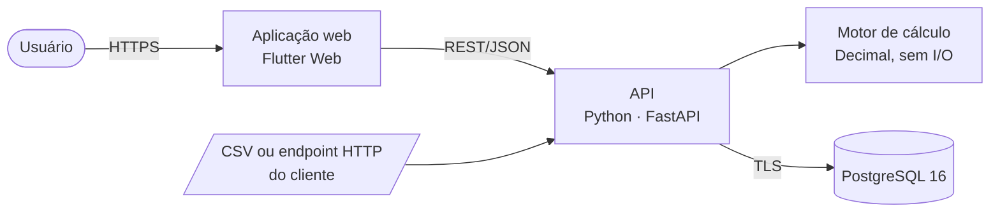

# Saldei — Especificações técnicas

Resumo técnico para quem avalia o produto. As contagens foram conferidas em 12/11/2026 na versão atual.

## Arquitetura

| Camada | Tecnologia | Responsabilidade |
|---|---|---|
| Web | Flutter Web (Dart 3), Riverpod, go_router | Formulários, navegação e exibição; nenhum cálculo financeiro |
| API | Python 3.12, FastAPI, Pydantic v2, SQLAlchemy 2.0 | Validação, regras de negócio, transações, auditoria e permissões |
| Motor | Python puro com `Decimal` | DRE, ponte do resultado, decomposição de receita e conciliação de estoque |
| Banco | PostgreSQL 16 com migrações versionadas | Fatos, versões de parâmetros, auditoria e resultados persistidos |
| Hospedagem | Vercel (API e web) e Supabase (banco), uma instalação por cliente; imagem Docker para quem hospeda | |

## Regras de cálculo

| Item | Regra |
|---|---|
| Receita líquida | Valor bruto menos desconto |
| Remuneração variável | Percentual ou valor fixo por vínculo profissional × serviço, arredondada por ordem |
| Taxa de meio de pagamento | Percentual configurável por cliente, arredondado por ordem e gravado na ordem |
| Material padrão | Ficha técnica do serviço × custo unitário vigente |
| Margem padrão | Receita líquida − remuneração − taxa − material padrão |
| Resultado gerencial | Margem padrão − ajuste de material do inventário − despesas fixas da competência |
| Decomposição da receita | Planejado → efeito volume → efeito mix → efeito preço → realizado |

Valores monetários usam `NUMERIC` no banco e `Decimal` no servidor, com arredondamento `ROUND_HALF_UP` a duas casas, e trafegam como texto até a tela.

## Integridade e histórico

- Preço, comissão, ficha técnica e custo têm vigência, com sobreposição impedida pelo banco.
- A ordem concluída guarda um retrato dos parâmetros usados e não é recalculada com valores novos, exceto por correção justificada e auditada.
- O registro de auditoria é somente inserção, encadeado por hash calculado no banco e protegido por gatilho.
- Concorrência otimista por versão em todo cadastro editável; transições de ordem e saídas de estoque com travas no banco.
- Criar ordens, despesas e movimentos de estoque exige chave de idempotência: o mesmo envio repetido não duplica.
- Não há exclusão física: cadastros são inativados, lançamentos e ordens são cancelados.

## Segurança

- Senhas guardadas só como hash, com política de tamanho mínimo e bloqueio de senhas comuns; senha provisória obriga a troca no primeiro acesso.
- Permissões por perfil verificadas pela API a cada requisição; desativar um usuário ou redefinir a senha encerra as sessões abertas.
- Limite de tentativas de login por usuário e por origem.
- Segredos só em variáveis de ambiente do servidor; nada sensível no aplicativo web.
- Política de segurança de conteúdo restrita à origem da API do cliente; CORS fechado.
- Banco com acesso público do provedor desligado.
- CPF, CNPJ, e-mail e telefone mascarados nos logs; erros nunca expõem detalhes internos.
- A aplicação recusa subir em produção com configuração insegura.

## Qualidade

| Verificação | Situação |
|---|---|
| Testes do backend | 527 testes: 305 unitários, 190 de integração contra PostgreSQL real e 32 de arquitetura; na última execução, 524 passaram e 3 foram pulados por depender de ambiente |
| Testes do frontend | 203 testes de widget e de unidade |
| Valores de referência | Os indicadores do conjunto de teste são conferidos por uma calculadora independente do motor |
| Análise estática | ruff, mypy estrito no motor e nos serviços, import-linter para as camadas, flutter analyze |
| Decisões de arquitetura | 37 registros de decisão (ADR) |

## Configuração por cliente

Um arquivo por cliente, validado por esquema na subida da API: marca (nome, slogan, cores com contraste mínimo verificado, tema), vocabulário do setor com gênero gramatical, módulos ligados e taxa do meio de pagamento. Favicon, ícones e manifesto do aplicativo são gerados a partir da marca.

## Fora do escopo atual

- Agenda, prontuário e emissão de nota fiscal: o Saldei complementa o sistema que já faz isso.
- Conectores prontos para sistemas específicos: a integração usa CSV ou endpoint HTTP.
- Várias empresas no mesmo banco: cada cliente tem sua instalação.
