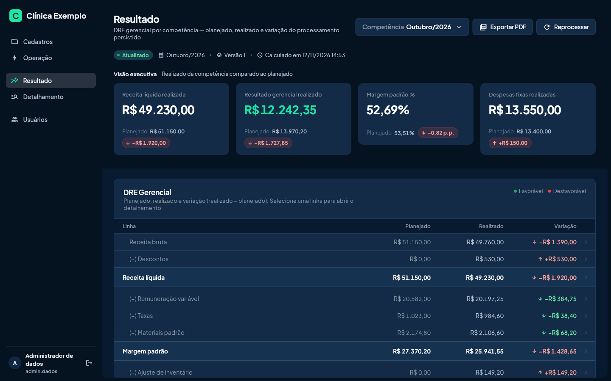
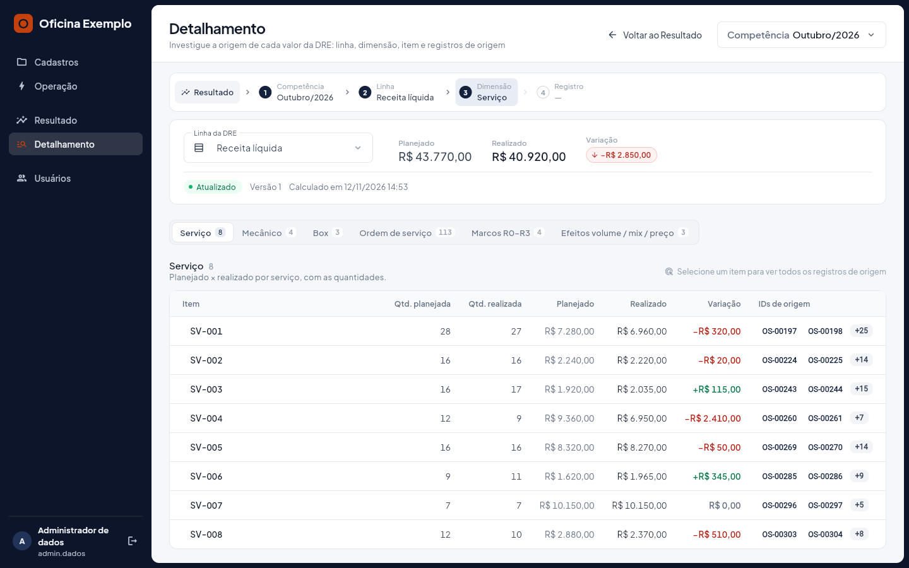
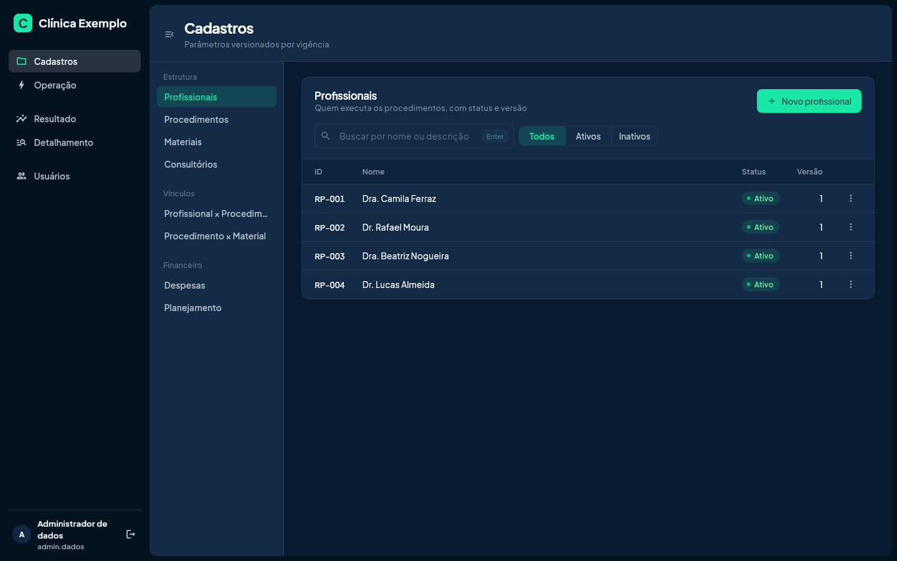
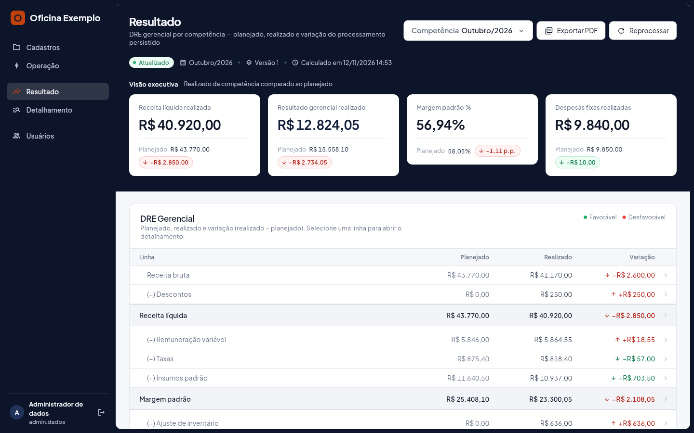
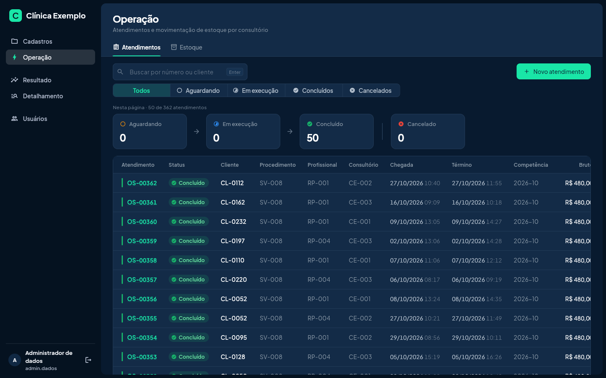
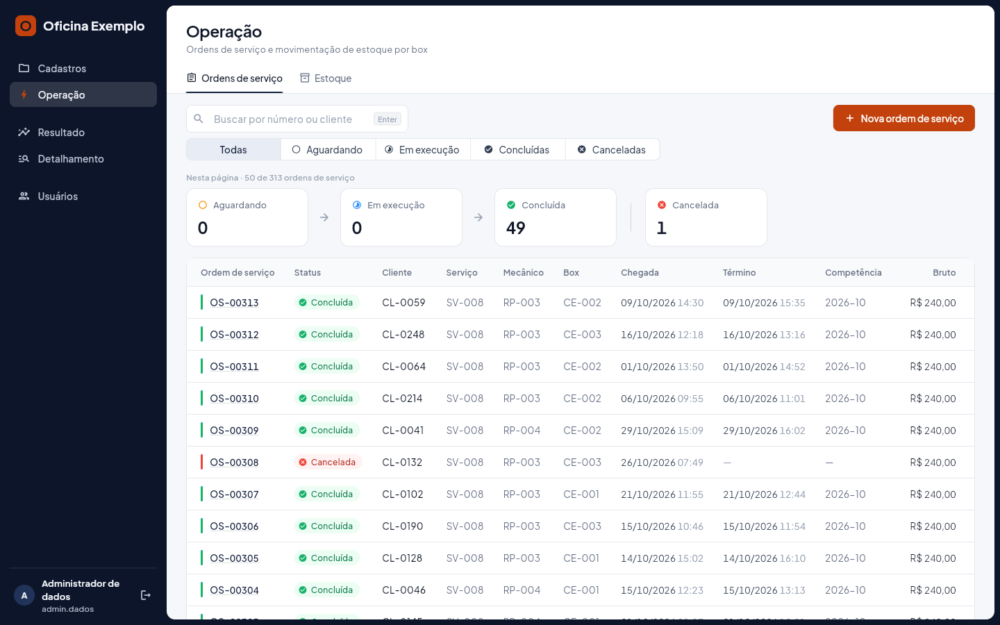
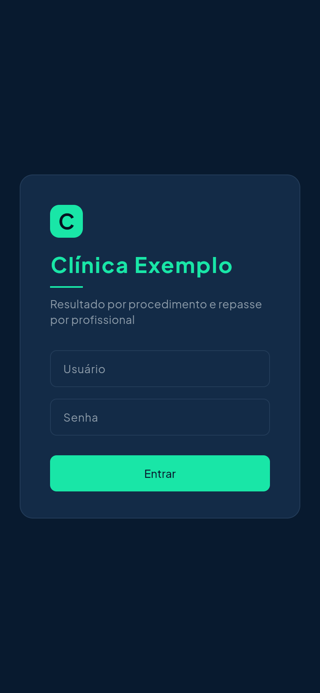
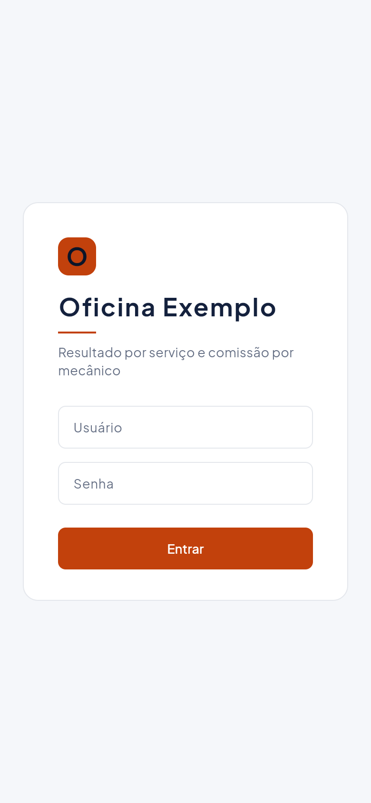

# Saldei

**Quanto cada serviço, cada profissional e cada unidade deixou de resultado no mês, e por que ficou diferente do planejado.**

O Saldei é uma plataforma de gestão de resultado por competência para negócios de serviço com equipe comissionada: clínicas, oficinas e outros negócios em que um profissional executa o serviço, recebe por ele e consome material. Ele fecha o mês numa DRE gerencial que compara o planejado com o realizado e leva cada desvio até o registro que o causou.

Produto da **LouizVolution**. Este repositório é a vitrine do produto: telas reais, funcionalidades e especificações técnicas. O código-fonte não está aqui.

## O problema

O sistema de agenda e o financeiro mostram quanto entrou. Eles não respondem:

- Qual procedimento ou serviço dá margem de verdade, depois da comissão, da taxa do cartão e do material?
- O repasse do profissional saiu certo?
- Por que o resultado do mês ficou abaixo do planejado: foi volume, mix de serviços ou preço?
- O material consumido bate com o que deveria ter sido usado?

## O que o Saldei faz

| Área | O que entrega |
|---|---|
| **Cadastros** | Profissionais, serviços, materiais e unidades, com preço, comissão, ficha técnica e custo versionados por vigência. Mudar um preço hoje não altera o mês passado |
| **Operação** | Ordens de serviço com fluxo de status, e estoque por unidade com recebimentos, transferências, devoluções e perdas |
| **Resultado** | DRE gerencial do mês, planejado × realizado, com ponte do resultado e decomposição da receita em volume, mix e preço |
| **Detalhamento** | De qualquer linha da DRE até a ordem, o lançamento ou a contagem de estoque que a compôs |
| **Análise e relatório** | Leitura automática do resultado, com os principais desvios e suas causas, e relatório executivo em PDF |
| **Governança** | Toda alteração auditada com autor, data, valor anterior e novo; ordem concluída só é corrigida com justificativa |
| **Usuários** | Perfis de operador, analista, controller e administrador, cada um vendo só o que pode usar |

## Feito para o seu negócio

Cada cliente recebe a própria instalação, com banco de dados exclusivo, e a configura assim:

- **Marca:** nome, slogan, cores, ícone e tema claro ou escuro.
- **Vocabulário do setor:** a clínica vê profissionais, procedimentos, materiais e consultórios; a oficina vê mecânicos, serviços, insumos e boxes.
- **Módulos:** estoque, detalhamento, análise e relatório ligados conforme o plano.
- **Taxa do meio de pagamento:** do próprio cliente, gravada em cada ordem.

| Clínica odontológica, tema escuro | Oficina, tema claro |
|---|---|
|  |  |
|  |  |
|  |  |

Os dados das telas são fictícios, gerados para demonstração.

## Como os dados chegam

O Saldei complementa o sistema que o negócio já usa, em vez de substituí-lo. Os dados entram por:

- **Arquivo CSV**, exportado do sistema atual ou de uma planilha, com importação idempotente: reenviar o mesmo arquivo não duplica nada.
- **Endpoint HTTP** do sistema do cliente, lido pelo Saldei no mesmo formato.
- **Lançamento direto** nas telas de cadastro e operação.

## Por que confiar no número

- **Todo cálculo acontece no servidor**, com aritmética decimal exata e arredondamento por ordem. A tela só exibe.
- **O mês fechado não muda sozinho.** Cada ordem concluída guarda os preços, a comissão e a taxa usados no dia.
- **Resultado persistido.** A DRE é calculada uma vez por versão e lida pronta; trocar um filtro nunca recalcula.
- **Auditoria à prova de adulteração.** O registro de alterações é encadeado por hash e protegido no banco.

Detalhes em [ESPECIFICACOES-TECNICAS.md](ESPECIFICACOES-TECNICAS.md).

## Contato

LouizVolution

- E-mail: [luizricardorodrigues0102@gmail.com](mailto:luizricardorodrigues0102@gmail.com)
- WhatsApp: [(64) 99334-7799](https://wa.me/5564993347799)

---

© 2026 LouizVolution. Todos os direitos reservados. Veja [LICENSE](LICENSE).
